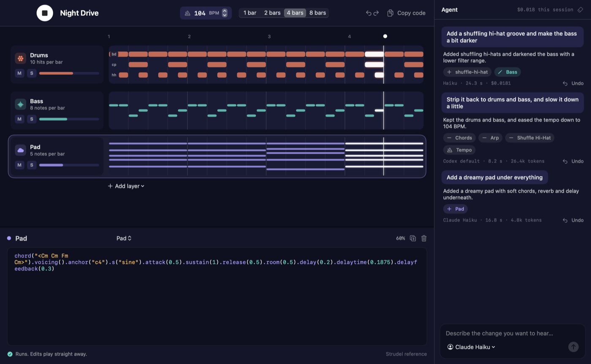

# Vamp

Vamp is a macOS app that makes music from prompts. You describe a change in plain words. An agent edits the song, and Vamp plays it straight away. Every layer is visible as a score and as code, so you can see what changed and adjust it by hand.



## What it does

- **Score view.** Each layer is a lane. Melodic layers show a piano roll. Drum layers show one row per sound. A playhead moves across all lanes, and the notes under it light up.
- **Layers.** Each layer has its own name, role, volume, mute and solo controls.
- **Code.** Select a layer to see its [Strudel](https://strudel.cc) code. Edits play as soon as the code runs. If the code breaks, the last working version keeps playing, and the error shows under the editor.
- **Agent.** Type a request such as "add a shuffling hi-hat groove". The agent returns only the edits it needs: add, change or remove a layer, or set the tempo. Vamp checks the new code before it plays. If the code fails, Vamp sends the errors back once for a fix.
- **Undo.** Every agent change has its own Undo button. ⌘Z and ⇧⌘Z move through all versions of the song.
- **Export.** "Copy code" copies the whole song as one Strudel program that runs on strudel.cc.

## Agent backends

Choose the backend from the menu in the prompt box or in Settings (⌘,).

| Backend | Needs | Cost |
|---|---|---|
| Claude subscription | The `claude` CLI, signed in | Included in your Claude plan |
| ChatGPT subscription | The `codex` CLI, signed in | Included in your ChatGPT plan |
| Anthropic API key | A key, stored in the login keychain | Pay per request. The log shows the cost of each prompt. |

The default model is Claude Haiku, the cheapest choice. Each request sends only the current song as JSON, a short summary of the last four prompts and the new request. A typical prompt uses about 5k tokens with the Claude CLI. The Codex CLI adds its own agent prompt, so it uses about 25k tokens.

Vamp looks for the CLIs in `/opt/homebrew/bin`, `/usr/local/bin`, `~/.local/bin` and some other common install folders.

## Build and run

You need macOS 14 or later and Xcode 16 or later.

```bash
scripts/build-app.sh          # builds build/Vamp.app (release)
open build/Vamp.app
```

The first start downloads the drum and instrument samples from the [Dirt-Samples](https://github.com/tidalcycles/Dirt-Samples) repository. Without a network, the synths still play, but sample layers show an "Unknown sound" error.

Shortcuts: Space plays and stops when no text field has focus. Return or ⌘↩ sends the prompt. ⌥⌘↩ plays and stops from anywhere.

## Tests

```bash
swift test                          # song model, edit plans, backend parsers, agent repair loop
node --test Tests/engine/*.test.mjs # the Strudel bridge: analysis, chord and sound checks
```

## How it fits together

- `Sources/VampCore`: the song model, the edit plan schema, the agent prompt, the output parsers and the repair loop. It has no UI code and full unit tests.
- `Sources/Vamp`: the SwiftUI app. `Engine/StrudelEngine.swift` hosts Strudel in a hidden web view. `Agent/` runs the three backends.
- `Resources/engine`: `engine.js` connects Swift to Strudel. `strudel.js` is the `@strudel/web` 1.3.0 bundle.

### Developer hooks

The app reads these environment variables at launch. Use them for checks without a mouse:

```bash
VAMP_PLAY=1 VAMP_PROMPT="make it darker" VAMP_SNAPSHOT=/tmp/vamp.png VAMP_SNAPSHOT_DELAY=30 \
  build/Vamp.app/Contents/MacOS/Vamp
```

## Licence

Vamp is free software under the [GNU AGPL-3.0](LICENSE). It bundles [Strudel](https://codeberg.org/uzu/strudel), which has the same licence.
